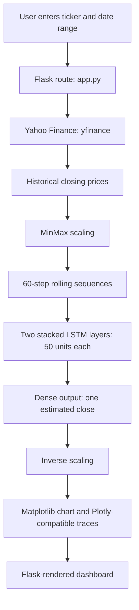
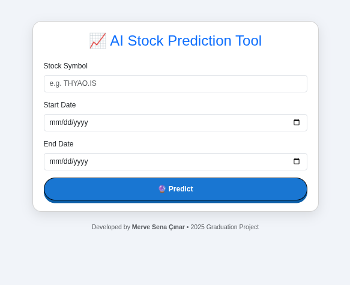
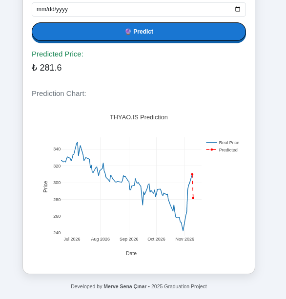

# AI Stock Predictor

### Stock market time-series forecasting with a stacked LSTM and a Flask web interface

**Computer Engineering Graduation Project · Üsküdar University · 2025**  · **Developer:** Merve Sena Çınar · [GitHub](https://github.com/mervesenacnr)

AI Stock Predictor is an educational machine-learning prototype for exploring **stock-price time series**, training a **Long Short-Term Memory (LSTM)** neural network on historical closing prices, and presenting a next-step price estimate in a browser-based interface. It connects data retrieval, preprocessing, sequence modeling, and visualization into a single Python/Flask workflow.

> **Research prototype - not investment advice.** The current implementation has not established out-of-sample forecasting accuracy. Charts and numerical forecasts should not be interpreted as reliable investment signals.

## Project at a glance

| Component | Implementation |
| --- | --- |
| Research domain | Financial time-series analysis and one-step price forecasting |
| Data source | Yahoo Finance through `yfinance` |
| Model | Two-layer stacked LSTM, implemented with TensorFlow/Keras |
| Input | Historical `Close` prices, with a 60-observation lookback window |
| Architecture | `LSTM(50, return_sequences=True) → LSTM(50) → Dense(1)` |
| Training settings | Adam optimizer, mean squared error (MSE) loss, 5 epochs, batch size 32 |
| Preprocessing | `MinMaxScaler` from scikit-learn |
| Backend | Python + Flask |
| Visualization | Matplotlib image and Plotly-compatible JSON traces |
| Outputs | Estimated next closing-price value and a historical/forecast chart |

## Features

- **Symbol selection:** request historical prices for a stock symbol accepted by Yahoo Finance (for example, `THYAO.IS`).
- **Date-range input:** select the beginning and end of the requested historical interval.
- **On-demand training:** construct 60-step sequences and train an LSTM from the retrieved data when a forecast is requested.
- **Next-step forecast:** use the final 60 observed closing prices as the model input to estimate the following step.
- **Visual explanation:** compare recent observed prices with the model's predicted extension using a static Matplotlib chart and Plotly-compatible series.
- **Web access:** submit requests through a Flask-rendered HTML interface.

The application needs an internet connection to retrieve market data. It does **not** ship with a trained model, a live trading engine, or verified forecasting-performance benchmarks.

## System architecture

GitHub renders the following Mermaid diagram directly in this README:



### LSTM network

```text
Historical close-price sequence
       │
       ▼
Input: 60 observations × 1 feature
       │
       ▼
LSTM layer: 50 units, return_sequences=True
       │
       ▼
LSTM layer: 50 units
       │
       ▼
Dense layer: 1 output
       │
       ▼
Estimated next-step closing price
```

The LSTM is trained *at request time* with an MSE objective and Adam optimization. The next-step prediction is inverse-transformed back to the price scale for display.

## Data and modeling workflow

1. **Download historical observations.** `yf.download()` requests data for the selected ticker and date range. The model uses the `Close` column.
2. **Validate basic availability.** Empty responses and histories shorter than 100 rows are rejected.
3. **Normalize the price series.** `MinMaxScaler` transforms historical closing prices.
4. **Prepare supervised windows.** Each training sample contains the preceding **60 observations** and targets the following closing price.
5. **Train the model.** The two-layer Keras LSTM is fitted for **5 epochs**, with **batch size 32**.
6. **Calculate an in-sample score.** The code reports `R²` over the training sequences. **This is not a held-out test score.**
7. **Predict from the most recent window.** The final 60 observations are passed to the trained model to estimate the next step.
8. **Render the result.** The backend returns a base64-encoded Matplotlib chart, an estimated value, and Plotly-compatible chart data to the HTML template.

The present code adds one calendar day to the final recorded date for plotting; this is **not** a verified next-trading-session calendar. It also fits the scaler to the complete downloaded series, which is unsuitable for a leakage-free future evaluation.

## Application preview

The screenshots below were captured during a **real local run** of the Flask application. The first shows the stock-symbol and date-range form; the second shows the forecast result and interactive chart rendered for `THYAO.IS`.

| Stock selection and date-range form | Example LSTM forecast result |
| :---: | :---: |
|  |  |

**Example shown:** `THYAO.IS` · displayed predicted closing price **₺281.60** · observed prices and the modeled next-step estimate are plotted separately. The displayed value documents one application run, **not** a validated forecast or a measure of predictive accuracy. Model output may vary between runs because training is stochastic.

## Repository structure

The structure below describes the **proposed single-version layout after promoting the LSTM application to the repository root**:

```text
AI-Stock-Predictor/
├── app.py                  # Flask routes, request parameters, template rendering
├── model.py                # Data preparation, LSTM training, forecast, charts
├── templates/
│   └── index.html          # User interface
├── static/
│   └── css/
│       └── style.css       # Frontend styling
├── requirements.txt        # Python package requirements
├── docs/
│   └── assets/
│       ├── dashboard.png          # Real Flask input-form screenshot
│       └── forecast-example.png   # Real example prediction chart
├── .gitignore
└── README.md
```

**Historical versions:** Earlier technical-indicator, Random Forest and notebook-based experiments remain accessible through Git history if removed from the current working tree. They are not the same implementation as the LSTM Flask application documented here.

## Getting started

### Prerequisites

- **Python 3.10** was used for a successful local run; a reproducible, version-pinned environment has not yet been published.
- `pip` and `venv`
- Internet access for Yahoo Finance requests

### Install

```bash
# Clone your repository
git clone https://github.com/mervesenacnr/AI-Stock-Predictor.git
cd AI-Stock-Predictor

# Create an isolated environment
python3 -m venv .venv
source .venv/bin/activate

# Install project dependencies
python -m pip install --upgrade pip
python -m pip install -r requirements.txt
```

### Run

```bash
python app.py
```

Visit **http://127.0.0.1:5000** and enter a supported ticker and a historical date range. An example input symbol is `THYAO.IS` (Borsa İstanbul); availability depends on Yahoo Finance.

> The Flask input and chart-rendering workflow has been exercised locally with Python 3.10. The dependency list is still unpinned, and reproducibility on other machines has not been established. If you encounter an error with newer `yfinance` responses or TensorFlow versions, record and resolve it before claiming cross-platform compatibility.
